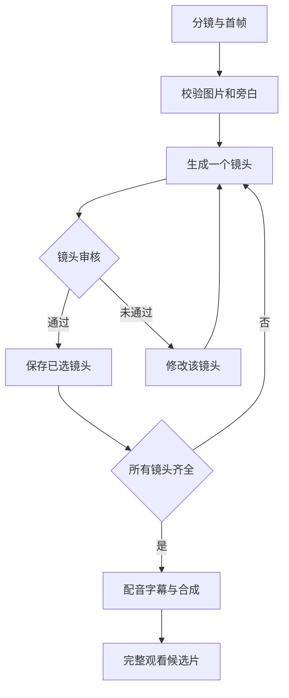

# FreeVideo 最小视频生成实施方案

在个人 FreeVideo fork 中增加一个独立的 Python 分镜脚本，复用原生 Agent Client 完成逐镜生成，使用 FFmpeg 合成配音和字幕。首版输入为已经确认的分镜、每镜首帧和可选旁白音频；目标交付一条约 60 秒、最多 12 镜头的候选片。

仓库：[yf0522/FreeVideo](https://github.com/yf0522/FreeVideo)。已核实 fork 的上游为 FlashML-org/FreeVideo；开发分支为 codex/storyboard-mvp，起始 commit 为 5f3659db1355a1e882ddb2e347d2c8c331d448bd。方案于 2026 年 10 月 27 日核对。

本文件是供 Codex 接续的实施任务书；当前只完成 fork、分支和方案，新脚本及实机视频验收尚未完成。

# 参考流程和证据边界

用户指定的[原帖](https://x.com/jarvis11x/status/2111026168526746057)指向《如何用 Muse+豆包 Work +ChatGPT，做出高质量稳定的长视频》。已核对 X 官方嵌入数据中的帖子、文章标题及摘要；X 长文全文未能直接取得。[明确指向同一原帖的整理](https://ttqq.dev/zh/tool/muse-doubao-work-chatgpt-long-video/)描述的核心流程是：先规划全片，固定人物和场景，逐镜制作首帧，再生成短片、审片和拼接。该整理声明未复现作者效果。

本方案移植这套流程，把视频生成环节接到 FreeVideo；分镜可以由 Codex、现有文本模型或人工完成，首帧可以在 ChatGPT 或已有工具中准备。首版不依赖对豆包、Muse 或 ChatGPT 网页的自动操作，也不承诺仅输入一句话就全自动完成。

FreeVideo 已有 Agent HTTP、CLI、MCP、任务队列及持久化。开发脚本直接复用[官方 Python Client](https://github.com/FlashML-org/FreeVideo/blob/5f3659db1355a1e882ddb2e347d2c8c331d448bd/freevideo_engine/agent/client.py)，只维护镜头与文件之间的关系。

# 首版范围

| 项目 | 首版约定 |
| --- | --- |
| 运行位置 | Apple Silicon Mac；先以 M4 Max 配置验证，实际内存、路径和环境由 Codex 核实 |
| 开发方式 | 个人 fork 的独立分支，新增分镜脚本及文档 |
| 内容类型 | 单角色、简单场景的安全故事或场景短片 |
| 输入 | 分镜清单、每镜已确认首帧、可选逐镜旁白 WAV |
| 生成参数 | 先用 960×544、Light、每镜请求 5 秒、串行 |
| 成片 | 1280×720、24 fps、H.264 视频和 AAC 音频，最多 12 镜头 |
| 时间槽 | 每镜 120 帧，即 5 秒；12 镜头共 1440 帧 |
| 声音 | 移除生成片段原声，加入用户提供的旁白；无口型同步承诺 |
| 字幕 | 每镜一句旁白，按该音频真实时长生成句级字幕 |
| 人工环节 | 确认首帧、播放检查每个镜头、完整观看候选片 |

首版独立运行，输入为本地清单、图片和音频，不依赖其他私有项目的数据库、TTS 接口或审核服务。

原生 FreeVideo 的角色库、影片模式和编辑器可以继续使用。本批次不开发另一套角色库、网页编辑器、多用户平台或多机调度。

# 最小工作流程



脚本恢复后先检查已有任务和文件，再决定是否提交新任务。每镜使用自己的已确认首帧；本批次不默认把上一镜末帧覆盖到下一镜，也不采用长视频连续扩展。

# Fork 和文件改动

已创建个人 fork 及 codex/storyboard-mvp 分支。Codex 接续时读取现有分支和工作区，确认 fork 的 parent.full_name 为 FlashML-org/FreeVideo，保留已有改动，继续在该开发分支实现。保留 main 作为上游同步基线；本次不向上游提交 PR。完成后提供个人 fork 的提交和测试证据。

拟新增文件如下。路径是本方案要求，不表示文件已存在。

| 文件 | 责任 |
| --- | --- |
| scripts/storyboard_mvp.py | 清单校验、逐镜调度、恢复、下载、FFmpeg 合成 |
| docs/examples/storyboard_mvp.json | 3 镜头示例清单 |
| docs/storyboard-mvp.zh-CN.md | 使用方法、故障处理、Mac 路径和更新说明 |
| scripts/test_storyboard_mvp.py | 对重复提交、输入变更、时长和失败恢复的必要验证 |

自定义清单放在 docs/examples，避免混入原生 ComfyUI 的 example_workflows。沿用现有测试组织方式，实际实现可按仓库惯例调整测试文件位置。

运行数据放在仓库之外的 workdir，包含首帧、声音、任务状态和输出视频；不提交真实声音资产、运行 token 或业务素材。

# 输入清单

以下是 15 秒流程验证样例；最终 60 秒验收需要 12 个独立镜头，不能把这 3 镜循环播放充数。

```json
{
  "schema_version": 1,
  "project_id": "safety-demo",
  "style": "同一名蓝色工装、白色安全帽的成年工作人员；同一车间通道；柔和自然光；写实风格",
  "render": {
    "width": 960,
    "height": 544,
    "seconds": 5,
    "quality": "light"
  },
  "export": {
    "width": 1280,
    "height": 720,
    "fps": 24
  },
  "shots": [
    {
      "id": "s01",
      "first_frame": "frames/s01.png",
      "prompt": "保持首帧中的人物和服装。工作人员站在车间通道入口，轻微转头观察，镜头缓慢推进。一个连续镜头，动作提前结束，无字幕和屏幕文字。",
      "seed": 20261027,
      "narration": {
        "audio": "audio/s01.wav",
        "text": "进入车间，先观察通道状况。"
      }
    },
    {
      "id": "s02",
      "first_frame": "frames/s02.png",
      "prompt": "保持同一人物和场景。人物停下脚步，看向通道边的物品。固定机位，单一缓慢动作，无字幕和屏幕文字。",
      "seed": 20261028,
      "narration": {
        "audio": "audio/s02.wav",
        "text": "发现异常，先停下确认。"
      }
    },
    {
      "id": "s03",
      "first_frame": "frames/s03.png",
      "prompt": "保持同一人物和服装。人物站在整洁的通道旁，平静地点头。固定镜头，最后保持片刻，无字幕和屏幕文字。",
      "seed": 20261029,
      "narration": {
        "audio": "audio/s03.wav",
        "text": "让安全检查，成为每天的习惯。"
      }
    }
  ]
}
```

所有相对路径以 manifest 所在目录解析。镜头 id 必须唯一；缺图、坏图、缺音频、非法时长或旁白超出时间槽时，整个项目先报错，不能已经提交前几镜才发现后几镜资产缺失。

首帧应使用同一角色参考图制作，再逐镜调整构图；seed 不代表人物身份锁定。人物、服装、场景和主要道具在首帧审核时就要一致。无旁白镜头显式使用 narration: null。

音频先准备、先测时长，再生成昂贵的视频。建议每镜音频在 0.15 秒处开始，音频结束加 0.15 秒余量不超过 5 秒，即音频不超过 4.7 秒；输入音频应清除明显前后空白。超长就缩短文案或重新配音，首版不自动加速。

# 原生 Client 接入

采用官方 Client，固定客户端名为 yf0522-storyboard-mvp。实际安装目录通过参数传入；Client 会读取该安装的 agent/endpoint.json 和 agent/token。token 只在本机运行时读取，不进入清单、日志或 Git。

基础调用顺序：

1. 读取 capabilities、schema 和 guide，确认正在运行的服务版本。
2. upload 上传已审核首帧，保存返回的 file。
3. 以完整请求调用 plan，记录实际 geometry、预计耗时和 warnings。
4. 持久化请求、稳定 ref 和镜头输入指纹，再调用 submit。
5. 立即保存返回的 job.id，随后按同一 ID 查询 job 或 wait。
6. 仅当状态为 succeeded 才下载 result.video.url 或通过 library_id 调用 asset。
7. ffprobe 校验文件，计算输出 hash，保存实际帧数和时长，再进入镜头审核。

[Client 源码](https://github.com/FlashML-org/FreeVideo/blob/5f3659db1355a1e882ddb2e347d2c8c331d448bd/freevideo_engine/agent/client.py)已提供上传、提交、查询、等待、取消、恢复和认证下载。wait 的 timeout 到期可能返回仍在运行的任务，调用者必须检查 status。

对应的 HTTP 请求示例：

```json
{
  "kind": "generate",
  "label": "通道观察",
  "project": "safety-demo",
  "prompt": "<已冻结并按 H3 格式编写的提示词>",
  "width": 960,
  "height": 544,
  "seconds": 5,
  "quality": "light",
  "seed": 20261027,
  "media": {
    "first": {
      "file": "<upload 返回的 file>"
    }
  },
  "ref": "safety-demo.s01.v1"
}
```

生成输入由[Agent schema](https://github.com/FlashML-org/FreeVideo/blob/5f3659db1355a1e882ddb2e347d2c8c331d448bd/freevideo_engine/agent/schema.py)定义。宽高要求为 32 的倍数；HTTP 不接受本地绝对路径。首帧 first 和非空 references 互斥，首版只用 first。实际客户端上传文件后，直接复用服务返回的 file。

提示词按[H3 指南](https://github.com/FlashML-org/FreeVideo/blob/5f3659db1355a1e882ddb2e347d2c8c331d448bd/freevideo_engine/agent/guide.py)组织动作、运镜及声音段落；可以在准备清单时把中文镜头意图改写成英文视觉描述。模板必须固定，不能每次恢复都让模型重新改写。首版使用外部旁白，要求人物不说话，生成音乐设为 N/A。

原生 drama 支持逐镜首帧，但当前 reshoot 的 changes 不含 first。因此，为支持“换首帧只重做一镜”，本次直接调用单镜 jobs；不需要修改 drama 核心接口。

# 恢复和局部重做

每个 workdir 保存一个原子写入的 state.json，同一目录只允许一个渲染进程持有锁。它只保存项目与 FreeVideo 任务的映射，不另建队列服务。

最小记录包括项目 id、manifest hash、fork commit、实际服务版本；每镜保存冻结请求、输入指纹、ref、job_id、上游状态、尝试次数、错误、下载路径、输出 hash 和 ffprobe 结果。

必须分别处理以下情况：

| 情况 | 处理 |
| --- | --- |
| 提交响应丢失 | 固定 client、相同 ref、相同 body 重放，找回原任务 |
| 已知任务尚未完成 | 查询原 job_id，不能因为轮询超时而再次生成 |
| 提示词、首帧、seed 或生成参数变化 | 新镜头版本和新 ref，旧文件保留 |
| 只修改旁白或字幕 | 复用画面，只重新处理音轨和合成 |
| 输出下载失败或中断 | 重下到临时文件，验证通过后再原子替换 |
| 已有视频文件缺失或 hash 不符 | 不计为缓存命中，先恢复下载或报错 |
| 用户取消 | 请求取消并等到终态；不自动恢复 |
| failed 或 interrupted | 明确执行 retry-failed 后恢复或重拍，仅处理该镜 |

原生[幂等和恢复实现](https://github.com/FlashML-org/FreeVideo/blob/5f3659db1355a1e882ddb2e347d2c8c331d448bd/freevideo_engine/agent/jobs.py)会拒绝同一个 key 对应不同请求。ref 与 Idempotency-Key 同时给出时必须相同。镜头网络重试继续使用原 ref；创作重拍才增加版本。

视频输入指纹包括首帧字节 hash、冻结后的完整提示词、seed、尺寸、质量、时长、模型与服务版本。旁白、字幕和合成另算指纹，避免换一句配音就重新推理视频。

上游 succeeded 只代表任务成功。缓存复用还要满足文件存在、hash 匹配、媒体校验通过。人工选择的镜头必须绑定当前输入版本和输出 hash；首帧或画面输入变化后，旧选择不能批准新输出，候选片需要重合成并重看。

每镜默认一次生成，人工要求重拍时最多再试一次；两次仍不满足就修改首帧、动作或机位。网络重试不计为新的创作尝试。总预算到达时停止提交新镜头并保存状态；轮询超时不等于取消正在生成的任务。

# 合成和候选片

每镜输出以 ffprobe 结果为准。FreeVideo 的单段帧数有对齐规则，请求 5 秒可能得到约 5.167 秒；不要直接把请求秒数相加当成成片时长。[时间与帧数说明](https://github.com/FlashML-org/FreeVideo/blob/5f3659db1355a1e882ddb2e347d2c8c331d448bd/freevideo_engine/agent/guide.py)

首版合成规则如下：

- 每镜准确保留 120 帧；素材不足 120 帧就报错。主要动作被尾部裁切截断时，镜审应判为不通过。
- 统一为 24 fps、1280×720、像素比例 1:1；等比缩放和补边，避免拉伸。这是输出画布，不表示原生生成了 720p 细节。
- 采用直接切换，避免转场重叠改变时长。
- 先移除各镜原声，再按镜头时间槽加入旁白，缺少旁白处补静音。
- 按逐句音频真实时长生成字幕，另存 SRT，并在候选片中烧录中文字幕。字体从可用系统字体或已有 FreeVideo 字体中明确选择。
- 不用按字数均分字幕，也不用 -shortest 隐式裁掉配音。
- 使用 subprocess 参数数组执行 FFmpeg，路径和文案不得拼进 shell 命令。

输出至少包含逐镜视频、state.json、candidate.mp4、subtitles.srt 和 timing.json。timing.json 区分冷启动、各镜生成、下载、合成以及重拍耗时。

每镜结果先形成可播放文件。由用户确认各镜后再合成；可以在工作目录保存 review.json，逐镜列出 approved 或 rejected、镜头版本及输出 hash。export 必须核对它与当前素材一致。这个文件是个人工作流的选片记录，不是多用户发布授权系统。

最终交付为候选片，用户必须完整播放检查人物、动作、切镜、配音和字幕。图片抽帧只用于发现问题，不能代替完整观看。本批次不自动公开发布。

# 命令与安装方式

以下是要由 Codex 实现的脚本命令，不是上游已存在的 FreeVideo 命令：

```text
storyboard_mvp.py validate --manifest <清单路径>
storyboard_mvp.py render --manifest <清单路径> --freevideo-root <安装目录> --workdir <项目目录>
storyboard_mvp.py render --manifest <清单路径> --freevideo-root <安装目录> --workdir <项目目录> --only s02
storyboard_mvp.py render --manifest <清单路径> --freevideo-root <安装目录> --workdir <项目目录> --retry-failed
storyboard_mvp.py status --workdir <项目目录> --freevideo-root <安装目录>
storyboard_mvp.py export --manifest <清单路径> --workdir <项目目录> --reviews <选片记录>
```

validate 只检查本地输入，不提交视频任务。render 恢复同一 workdir 时先复用有效成果；only 只提交指定镜头；全项目仍执行输入校验，其他镜头输入若已变更，其旧结果不得通过 export 校验。取消可以采用 render 的中断处理及官方 Client.cancel，不必增加另一套控制服务。

Mac 使用官方 Apple Silicon 安装流程，并在独立开发目录运行 fork 的脚本。Codex 应确认实际 Python、FFmpeg、安装目录及可用磁盘，输出对应机器可直接运行的命令，不能照抄 Linux 的 setup.sh 或硬编码未经核实的路径。

FreeVideo 的 Mac 支持为实验性，Metal/MLX 执行路径与 CUDA 不同。[官方 Mac 指南](https://github.com/FlashML-org/FreeVideo/blob/5f3659db1355a1e882ddb2e347d2c8c331d448bd/docs/Mac.md)

# 上游更新和许可证

自定义脚本保留在独立 fork checkout，运行输入输出保留在外部 workdir，不直接修改 FreeVideo.app、托管的 engine-source、source-overlay 或更新包。

上游[launcher_update.py](https://github.com/FlashML-org/FreeVideo/blob/5f3659db1355a1e882ddb2e347d2c8c331d448bd/freevideo_engine/launcher_update.py)仍指向 FlashML-org/FreeVideo；[Mac 更新器](https://github.com/FlashML-org/FreeVideo/blob/5f3659db1355a1e882ddb2e347d2c8c331d448bd/freevideo_engine/mac_app_update.py)可以替换应用。只把 git remote 改成个人 fork，不会改变官方安装器的更新来源。首版保留官方更新和签名校验，自定义脚本调用其 API。服务升级后，先重新检查 schema 并做单镜测试，再继续批量任务。

FreeVideo 代码采用 Apache-2.0，模型权重采用 MiniMax H3 Community License，不能把两者视为同一个许可。[第三方许可说明](https://github.com/FlashML-org/FreeVideo/blob/5f3659db1355a1e882ddb2e347d2c8c331d448bd/THIRD_PARTY_NOTICES.md)

[模型许可](https://huggingface.co/OpenVDN/vdn-minimax-h3-edge/blob/main/LICENSE)列有地域和商用条件，其中排除欧盟、英国、韩国和美国，并涉及模型输出在适用地区之外的使用、分发及展示。实际部署和输出用途须符合该许可；涉及排除地区时先取得相应授权。本批次的 fork 和文档工作不代表模型部署或使用已获许可。

# 验收次序

| 阶段 | 交付 | 通过标准 |
| --- | --- | --- |
| A 单镜测速 | 1 个约 5 秒真实视频和 timing 记录 | 首帧实际参与生成，结果可下载、可解码，记录设备和参数 |
| B 流程验证 | 3 镜约 15 秒候选片 | 首帧、配音、字幕、选片、拼接和恢复全部走通 |
| C 最小成片 | 12 镜约 60 秒候选片 | 1440 帧，所有镜头为当前版本且通过人工检查，完整播放通过 |

社区记录中，M4 Max 64GB、768×1344、5 秒、Light、v0.3.5 的端到端耗时为 2078 秒。这个旧版竖屏样本不能当成目标机器的预测值，也不能据此承诺一分钟视频在 15 分钟内完成。[社区实测](https://github.com/FlashML-org/FreeVideo/blob/5f3659db1355a1e882ddb2e347d2c8c331d448bd/docs/community-results.md)

先取得本机首镜与后续镜头的真实速度，再估算批量任务。安装、权重下载、推理和人工审核耗时分别报告。

必要的行为验证：

1. 提交后模拟网络中断，恢复只关联原任务，不重复推理。
2. 脚本重启后复用已验证的完整镜头。
3. 修改第二镜首帧，只重做第二镜；旧选片记录不能用于新结果。
4. 修改旁白只重新合成，画面不重算。
5. 旁白超过时间槽时，在任何视频任务提交前报错。
6. 某镜失败、被拒或缺失时，不能静默跳过，也不能用旧片或静态占位替代。
7. 取消后停止继续提交镜头，不自动恢复已取消任务。
8. 缺 token、错误服务地址、非法尺寸和媒体损坏时，返回清楚错误并保留已有成果。
9. 60 秒视频无裁掉旁白、字幕越界、拉伸、黑帧或明显动作截断；句级字幕与声音边界误差目标不超过 300 毫秒，人工核验。
10. 完整观看全部镜头及最终候选片，核查人物数量、脸、发型、工装、安全帽、场景及动作方向。

静态校验和 mock 测试不能证明真实推理通过。若只完成 B，必须明确写“15 秒流程通过，60 秒实机验收未完成”，不能报整项完成。

# 交给 Codex 的执行要求

```text
请基于 yf0522/FreeVideo 的个人 fork 完成本方案。

先核实 fork 的 parent、现有分支和上游 commit，使用已创建的 codex/storyboard-mvp 分支。
先读仓库中的实际说明和现有 Client、schema、jobs、guide，按当前固定版本开发。
新增一个 scripts/storyboard_mvp.py，直接复用 FreeVideo 官方 Python Client。
首版接受已确认的每镜首帧和可选逐镜旁白文件，不绑定其他私有项目或网页自动化。
实现 validate、render、status、export；支持 only 指定镜头、明确 retry-failed、取消和跨进程恢复。
用稳定 ref 处理网络重放；换首帧或生成参数产生新镜头版本，旁白变化不能触发画面重生成。
复用原生队列和媒体下载，使用 FFmpeg 处理准确帧数、旁白、中文字幕与候选片。
保留镜头 hash 和简单人工选片记录；export 校验当前素材版本。
不要修改模型推理核心、官方更新源、签名规则，或把自定义代码写入安装器管理的目录。
先做 1×5 秒设备测试，再做 3×5 秒流程验证，最后做 60 秒成片验收。
输出代码、示例、中文说明、必要测试、真实耗时和未完成项；区分 mock、真实生成及人工审核。
工作保存在个人 fork 的开发分支，并提供提交或 Draft PR。
```

实际执行若缺少 GitHub 登录、模型授权、首帧或音频，先完成不依赖它们的代码和文档，并明确具体缺项；不要伪造资产、任务结果或验收状态。
